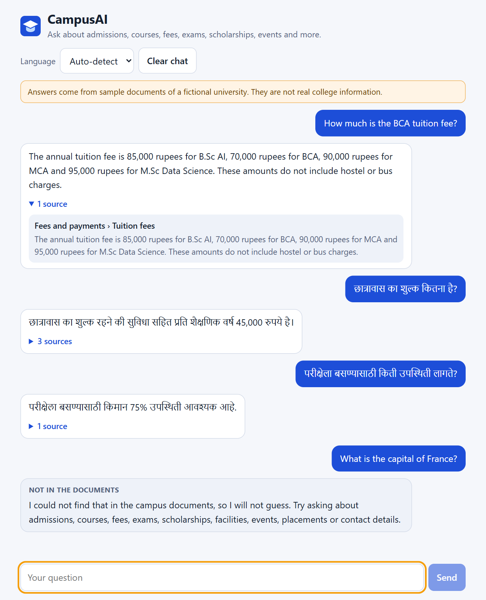
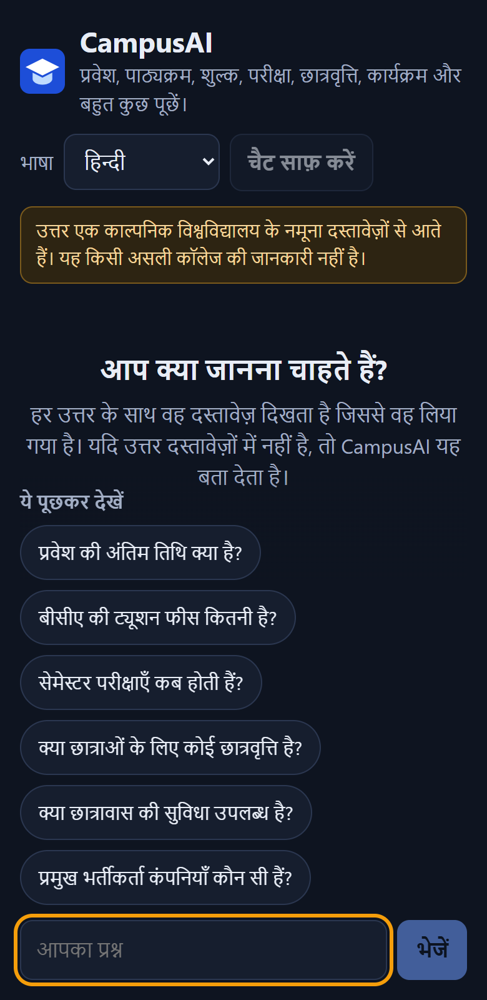
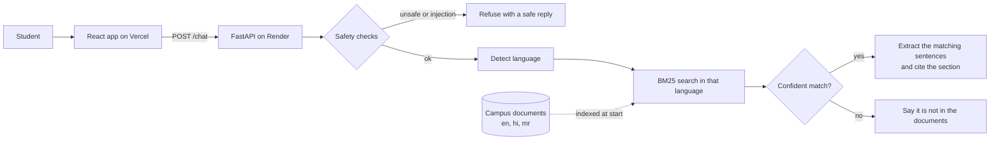

# CampusAI

**Campus questions, answered from the actual documents, with sources, in English, Hindi and Marathi.**

[](https://github.com/ShriyaP1966/CampusAI-NLP-Chatbot/actions/workflows/ci.yml)


CampusAI is a retrieval-based question answering system for university information. It finds the section of a campus document that answers a question, shows exactly which document it came from, and says so when the answer is not in the documents instead of guessing. It runs with no API key and no model download.

## Live demo

- **App:** https://campus-ai-nlp-chatbot.vercel.app
- **API:** https://campusai-api-wrzj.onrender.com (`/health`, `/docs`)

> The backend runs on a free Render instance that sleeps when nobody uses it. **The first request can take up to a minute**; the app shows a "Waking up the server" message while it starts.
>
> All data is **sample data for a fictional university** ("Northfield University"). It is not real college information.

<p align="center">
  
  
</p>

## Features

- **Grounded answers.** Answers are extracted from the best-matching section of the documents. Every answer lists its sources, which can be expanded to show the original text.
- **Says when it does not know.** If no section matches the question well enough, the bot declines instead of inventing an answer.
- **English, Hindi and Marathi.** The language is detected from the question (or chosen in the selector), and the answer comes from documents in the same language. The interface is translated too.
- **Safety basics.** Prompt-injection attempts and clearly harmful requests are refused, self-harm messages get a supportive reply with a helpline, and document sections that try to instruct the assistant are excluded.
- **Evaluation built in.** A labelled question set and a script report retrieval accuracy, answer correctness, abstention and refusals per language.
- **Works without any key.** No paid API, no GPU, no model files. The backend uses about 50 MB of memory.
- **A clean chat UI.** Message history, suggested questions, language selector, loading, error and "waking up" states, dark mode, keyboard and screen-reader support.

## How it works



1. **Documents** are Markdown files split into short sections (`data/documents/`). A section is the unit that is indexed, retrieved and cited. The same section exists in English, Hindi and Marathi under the same id.
2. **Indexing** builds one BM25 index per language when the server starts. English uses words with light stemming and synonyms. Hindi and Marathi use character trigrams, because they inflect heavily (शुल्क, शुल्काचे), and Python's `\w` does not handle Devanagari vowel signs, so tokenization is done on Unicode categories.
3. **Answering** ranks the sections, and trusts the best one only if it covers enough of the question's (idf-weighted) terms. The answer is the sentences of that section that match the question, plus the sources.
4. **Safety** checks run before retrieval; documents are screened when they are loaded.

## Evaluation

`data/eval/questions.csv` holds 147 labelled questions: 119 answerable ones (with the expected source section and a phrase the answer must contain), 18 out-of-scope questions that must be declined, and 10 unsafe messages that must be refused. Rows are split into `dev` (used when choosing the confidence threshold) and `test`.

**Test split (88 questions):**

| Language | Questions | Language ID | Hit@1 | Hit@3 | MRR | Answer correct | Declined out-of-scope | Refused unsafe |
|---|---:|---:|---:|---:|---:|---:|---:|---:|
| English | 40 | 100.0% | 93.9% | 97.0% | 0.95 | 87.9% | 100.0% | 100.0% |
| Hindi | 24 | 100.0% | 90.0% | 95.0% | 0.92 | 80.0% | 66.7% | 100.0% |
| Marathi | 24 | 83.3% | 80.0% | 90.0% | 0.83 | 75.0% | 100.0% | 100.0% |
| **All** | 88 | 95.5% | 89.0% | 94.5% | 0.91 | 82.2% | 90.9% | 100.0% |

- *Hit@k*: the expected section is in the top k results. *Answer correct*: the bot answered, cited the expected section and the answer contains the expected phrase. *Declined out-of-scope*: it said "not in the documents".
- Reproduce with `python -m campusai.evaluate` (add `--failures` to list every miss). The full tables, including the dev split, are in [`evaluation/results.md`](evaluation/results.md), and CI fails if test-split quality drops below agreed minimums.

How to read these numbers:

- The question set is small and was written alongside the sample documents. Treat it as a regression guard and a baseline, not a benchmark.
- Most misses are lexical mismatches: the question uses different words from the document ("deadline" against "close"). That is the known limit of BM25, and a re-ranking step is one of the open issues.
- A lower English confidence threshold looked better on the dev split but made the bot answer out-of-scope questions on the test split, so the conservative threshold (0.5) is kept. The Hindi out-of-scope figure comes from one question about a PhD programme, which is close enough to the facilities text to be matched.

## Tech stack

| Layer | Technology |
|---|---|
| Retrieval | Pure-Python BM25, rule-based language detection, no ML dependencies |
| Backend | Python 3.11+, FastAPI, Uvicorn |
| Frontend | React 19, TypeScript, Vite |
| Tests and checks | pytest, ruff, Vitest, Testing Library, ESLint |
| CI | GitHub Actions (lint, tests, build for both halves), Dependabot |
| Hosting | Render (API, free tier), Vercel (frontend) |

## Run it locally

You need Python 3.11+ and Node.js 22+.

```bash
git clone https://github.com/ShriyaP1966/CampusAI-NLP-Chatbot.git
cd CampusAI-NLP-Chatbot

# Backend: http://localhost:8000 (API docs at /docs)
python -m venv .venv
source .venv/bin/activate          # Windows: .venv\Scripts\activate
pip install -r requirements-dev.txt
uvicorn campusai.api:app --reload

# Frontend: http://localhost:5173 (second terminal)
cd frontend
cp .env.example .env.local         # VITE_API_URL=http://localhost:8000
npm ci
npm run dev
```

Quick check without the frontend:

```bash
curl -X POST localhost:8000/chat -H "Content-Type: application/json" \
  -d '{"message": "How much is the BCA tuition fee?"}'
```

### Tests and evaluation

```bash
ruff check . && ruff format --check .
pytest
python -m campusai.evaluate

cd frontend && npm run lint && npm run typecheck && npm test && npm run build
```

### Configuration

Everything is optional; see [`.env.example`](.env.example) and [`frontend/.env.example`](frontend/.env.example).

| Variable | Where | Purpose |
|---|---|---|
| `CORS_ORIGINS` | backend | Comma-separated origins allowed to call the API (the frontend URL). Defaults to the local dev server. |
| `CAMPUSAI_DOCS_DIR` | backend | Folder with your own documents. Defaults to `data/documents`. |
| `RATE_LIMIT_PER_MINUTE` | backend | Requests per client per minute (default 30). |
| `MAX_MESSAGE_LENGTH` | backend | Longest accepted message (default 500). |
| `VITE_API_URL` | frontend | Base URL of the backend, set at build time. |

### Use your own documents

Put Markdown files in a folder, one section per `## Heading {#id}`, and point `CAMPUSAI_DOCS_DIR` at it. The format is described in [`data/documents/README.md`](data/documents/README.md). Plain `.md` and `.txt` files without headings also work. Do not commit private or scraped college data.

## API

| Method and path | Purpose |
|---|---|
| `GET /health` | Status, version, number of indexed sections and languages. |
| `POST /chat` | Body `{"message": "...", "language": "auto" \| "en" \| "hi" \| "mr"}`. Returns `answer`, `status` (`answered`, `not_found`, `refused`), `language`, `confidence`, `sources` and `reason`. |
| `GET /suggestions?lang=en` | Suggested starter questions. |

There is deliberately no upload endpoint: a public demo should not accept uploads.

## Deployment

The backend and frontend are hosted separately. The backend is pure Python and needs a long-running server, which Vercel does not provide, so it runs on Render; the frontend is a static site on Vercel. Keeping them apart also means the page loads instantly while the free backend wakes up.

**Backend on Render.** The repo contains [`render.yaml`](render.yaml). In the Render dashboard choose New, then Blueprint, and select the repository. Set `CORS_ORIGINS` to the frontend URL (no trailing slash). No secrets are needed. The start command is `uvicorn campusai.api:app --host 0.0.0.0 --port $PORT` and Render checks `/health`.

**Frontend on Vercel.** Import the repository, set the Root Directory to `frontend` and add `VITE_API_URL` with the Render URL. [`frontend/vercel.json`](frontend/vercel.json) sets the build and security headers, including a content security policy that only allows API calls to `*.onrender.com`.

CORS means only the frontend's origin can call the API from a browser. Nothing secret is stored in the repository: the only configuration is the two URLs.

## Project structure

```
campusai/            backend package
  api.py             FastAPI app
  engine.py          retrieve, check confidence, extract the answer
  retriever.py       per-language BM25 search and confidence
  bm25.py            Okapi BM25
  text.py            tokenization, stop words, synonyms (en, hi, mr)
  language.py        language detection
  safety.py          injection, harmful and self-harm checks
  documents.py       document loading and section splitting
  evaluate.py        evaluation script
data/documents/      sample campus documents (en, hi, mr)
data/eval/           labelled evaluation questions
frontend/            React + TypeScript + Vite app
tests/               backend tests
render.yaml          Render blueprint (API)
```

## Known limitations

- **Sample data only.** The documents describe a fictional university.
- **Lexical retrieval.** BM25 matches words, so a question phrased very differently from the document can be missed or declined. Hindi and Marathi trigram matching helps with inflection but not with synonyms.
- **Hindi or Marathi in Latin letters** ("fees kitni hai") is not supported and is treated as English.
- **Short Devanagari questions** with no function words can be detected as Hindi even when they are Marathi. The language selector fixes this.
- **Safety checks are patterns**, not a classifier. They catch common, obvious cases and are not a complete defence.
- **Extractive answers.** The bot returns sentences from the documents; it does not rephrase or combine them.
- **Small evaluation set**, written by the project author. Numbers are indicative.
- **Free hosting.** The first request after a quiet period is slow, and the rate limiter is in memory, so it resets when the server restarts.

## Roadmap

Open issues for anyone who wants to help, including good first issues: [good first issue](https://github.com/ShriyaP1966/CampusAI-NLP-Chatbot/labels/good%20first%20issue) and [help wanted](https://github.com/ShriyaP1966/CampusAI-NLP-Chatbot/labels/help%20wanted). Ideas include an embedding re-ranker, romanised Hindi and Marathi, PDF and DOCX ingestion, and optional LLM rewriting. See [CONTRIBUTING.md](CONTRIBUTING.md) to get started.

## Why I built this

Students keep asking the same questions about courses, exams, fees and events, and the answers are scattered across notices and PDFs. I built CampusAI to answer them from the actual documents, with sources, instead of guessing. Building it taught me how to put together an NLP pipeline end to end: retrieval, multilingual handling, evaluation and deployment.

## Author

**Shriya Patil**, B.Sc. Artificial Intelligence student.

## License

MIT. See [LICENSE](LICENSE).
